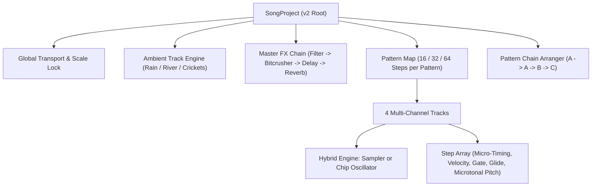

# Chiptune-16 Pro: JSON v2 Format Specification & Composition Guide

> **Specification Version:** 2.0.0  
> **Target Engine:** Chiptune-16 Pro Modular Web Workstation (`Tone.js` 15+ & Web Audio API)  
> **Document Status:** Production Standard  

---

## 1. 📖 Overview & Architecture

The **Chiptune-16 Pro Project Format (v2 Schema)** is a JSON-based music project specification designed for multi-track, microtonally tunable, sample-hybrid chiptune sequencing. It serves both as the project file format for the Chiptune-16 web workstation and as an export/import interchange standard for game audio engines (e.g., Godot 4.x, Unity, custom web runners).



### Architectural Pillars

1. **Decoupled Audio State**: The playback scheduler operates independently from the UI rendering layer using `Tone.Transport` and sample-accurate lookahead events. Playhead animations sync at 60 FPS via `Tone.Draw` and direct DOM element refs, preventing audio dropouts or UI stutter even on 64-step polyphonic patterns.
2. **True Microtonal Tuning**: Moving beyond western 12-Tone Equal Temperament (12-TET), the v2 engine features a native cent-based microtonal frequency mapping system. This delivers authentic non-Western scales—notably Javanese **Slendro** and **Pelog**—with mathematically accurate interval frequencies in Hertz.
3. **Pattern Chaining & Song Structures**: Instead of rigid single loops, projects manage independent pattern blocks (`pattern-a`, `pattern-b`, etc.) with configurable lengths (16, 32, or 64 steps) arranged into dynamic playback chains (`["pattern-a", "pattern-a", "pattern-b"]`).
4. **Hybrid Sound Generation**: Each track can seamlessly alternate between pure chiptune chip oscillators (`square`, `pulse 25%`, `triangle`, `noise`) and acoustic sampled instruments (**Saron**, **Bonang**, **Suling**, **Siter**, **Kendang**), backed by graceful synthesizer fallback.

---

## 2. ⚙️ Root Configuration Object Schema

The root JSON object defines global song properties, tempo, scale locking, active pattern routing, and pattern chain sequencing.

| Parameter | Type | Required | Range / Enum | Description |
|---|---|---|---|---|
| `version` | `number` | **Yes** | `2` | Schema specification version. Must be `2` for this specification. |
| `id` | `string` | **Yes** | Slug string (`[a-z0-9_-]+`) | Unique machine-readable identifier for the song project. |
| `name` | `string` | **Yes** | UTF-8 String (1–120 chars) | Human-readable title of the piece (e.g., `"Slow Living Under the Sultan's Sky"`). |
| `tempo` | `number` | **Yes** | `60` – `180` | Master song tempo in Beats Per Minute (BPM). |
| `swing` | `number` | **Yes** | `0.0` – `1.0` | 16th-note swing factor (`0.0` = straight timing, `0.15`–`0.25` = organic human groove). |
| `activeScale` | `string` | **Yes** | Enum (see below) | Global scale lock applied to note selection matrices. |
| `activePatternId` | `string` | **Yes** | Pattern ID string | Default pattern actively loaded in the editor (e.g., `"pattern-a"`). |
| `chainMode` | `boolean` | **Yes** | `true` \| `false` | When `true`, playback sequences through `patternChain`. When `false`, loops `activePatternId`. |
| `patternChain` | `string[]`| **Yes** | Array of Pattern IDs | Ordered arrangement list determining song structure (e.g. `["pattern-a", "pattern-b"]`). |
| `masterFx` | `object` | **Yes** | `MasterFxSettings` | Master signal processing chain parameters. |
| `ambientTrack` | `object` | **Yes** | `AmbientTrackSettings`| Continuous atmospheric background layer settings. |
| `patterns` | `object` | **Yes** | `Record<string, PatternData>` | Key-value dictionary containing pattern data objects. |

### Valid Values for `activeScale`

- `"pelog"`: Authentic 7-tone non-equal Javanese gamelan tuning.
- `"slendro"`: Authentic 5-tone equidistant Javanese gamelan tuning (~240 cents).
- `"pentatonic-minor"`: Standard western 12-TET minor pentatonic scale.
- `"dorian"`: Traditional medieval/RPG Dorian mode (12-TET).
- `"chromatic"`: Full 12-TET chromatic keyboard (all 12 semitones).

---

## 3. 🌿 Ambient & Spatial Audio Settings (`ambientTrack`)

The `ambientTrack` object manages an independent background atmospheric generator. It operates as a continuous stereo sound bed routed into the master bus alongside the music.

```json
"ambientTrack": {
  "enabled": true,
  "soundType": "crickets",
  "volume": -14,
  "filterCutoff": 3800
}
```

### Parameter Reference

| Field | Type | Unit | Range / Values | Description |
|---|---|---|---|---|
| `enabled` | `boolean` | — | `true` \| `false` | Master toggle for the ambient atmospheric generator. |
| `soundType` | `string` | — | `"crickets"`, `"rain"`, `"river"`, `"off"` | Procedural audio soundscape preset. |
| `volume` | `number` | dB | `-30` to `0` | Gain level in decibels (`0` = unity gain, `-14` = standard background level). |
| `filterCutoff`| `number` | Hz | `500` to `12000` | Low-pass filter cutoff frequency applied to the ambient track. |

### Sound Preset Characteristics

- **`crickets`**: Multi-voice nocturnal insect chirping synthesized via pulsed high-register oscillators ($4.4\text{ kHz}$ – $4.8\text{ kHz}$) with irregular biological envelopes.
- **`rain`**: Dual-channel continuous pink noise combined with randomized micro-droplet resonant clicks ($1.8\text{ kHz} \rightarrow 300\text{ Hz}$).
- **`river`**: Resonant bandpass-filtered noise ($650\text{ Hz}$, $Q=1.8$) simulating babbling mountain water currents.
- **`off`**: Bypasses the ambient audio node graph entirely.

---

## 4. 🎛️ Master FX Pipeline (`masterFx`)

The master audio bus processes all track outputs through a sequential retro hardware DSP chain before reaching the master output and visualizer oscilloscope:

$$\text{Tracks Bus} \longrightarrow \text{Bitcrusher} \longrightarrow \text{Stereo Delay} \longrightarrow \text{Master Filter} \longrightarrow \text{Algorithmic Reverb} \longrightarrow \text{Master Gain}$$

```json
"masterFx": {
  "bitcrusher": {
    "enabled": true,
    "bits": 12,
    "downsample": 1
  },
  "delay": {
    "enabled": true,
    "time": "8n",
    "feedback": 0.32,
    "wet": 0.22
  },
  "filter": {
    "enabled": true,
    "cutoff": 11000,
    "resonance": 1.2
  },
  "reverb": {
    "enabled": true,
    "roomSize": 0.65,
    "dampening": 2800,
    "wet": 0.28
  }
}
```

### Module 1: `bitcrusher`
Simulates early digital console DAC (Digital-to-Analog Converter) quantization characteristics.
- `enabled` (`boolean`): Toggles the bit-reduction circuit.
- `bits` (`number`, `1` – `16`): Target bit-depth quantization. Common targets:
  - `4`: Extreme vintage lofi crunch (early handheld).
  - `8`: NES / Game Boy DMG classic 8-bit grit.
  - `12`: Amiga 500 / early 90s tracker warmth.
  - `16`: Clean CD / SNES studio master quality.
- `downsample` (`number`, `1` – `16`): Sample rate downsampling factor (`1` = 44.1 kHz, `2` = 22.05 kHz, `4` = 11.025 kHz).

### Module 2: `delay`
Tempo-synchronized stereo tape/echo delay.
- `enabled` (`boolean`): Toggles the delay effect.
- `time` (`string`): Musical subdivision timing: `"16n"` (16th note), `"8n"` (8th note), `"8t"` (triplet), `"4n"` (quarter note).
- `feedback` (`number`, `0.0` – `0.9`): Echo decay repetition length (`0.0` = single slapback, `0.35` = spacious trails).
- `wet` (`number`, `0.0` – `1.0`): Wet/dry balance ratio (`0.20` – `0.30` recommended for ambient clarity).

### Module 3: `filter`
12 dB/octave state-variable resonant low-pass filter.
- `enabled` (`boolean`): Toggles master frequency attenuation.
- `cutoff` (`number`, `200` – `16000` Hz): Corner frequency where high frequencies begin rolling off.
- `resonance` (`number`, `0.1` – `10.0`): Quality factor ($Q$). High values add a nostalgic analog synth sweep peak.

### Module 4: `reverb`
Algorithmic space simulation using comb/all-pass filter topologies.
- `enabled` (`boolean`): Toggles reverberation.
- `roomSize` (`number`, `0.0` – `0.95`): Spatial dimension dimensioning (`0.3` = wooden room, `0.7` = stone temple / open valley).
- `dampening` (`number`, `100` – `10000` Hz): High-frequency absorption frequency. Simulates soft acoustic materials.
- `wet` (`number`, `0.0` – `1.0`): Spatial reverberant mix ratio.

---

## 5. 🎼 Patterns & Track Structure (`patterns`)

The `patterns` map stores all discrete musical sections of the composition. Each pattern contains an array of 4 dedicated channel tracks.

```json
"patterns": {
  "pattern-a": {
    "id": "pattern-a",
    "name": "Pattern A: Morning Village Mist",
    "stepCount": 16,
    "tracks": [ ... ]
  }
}
```

### Pattern Object Schema

| Parameter | Type | Range | Description |
|---|---|---|---|
| `id` | `string` | Unique key | Pattern identifier matching the dictionary key. |
| `name` | `string` | UTF-8 String | Display title of the pattern (e.g. `"Pattern A - Intro"`). |
| `stepCount`| `number` | `16`, `32`, `64` | Total horizontal steps executed by this pattern. |
| `tracks` | `array` | 4 Track Objects | Ordered array of track configuration objects. |

### Track Object Specification

Every pattern must define exactly 4 tracks representing the classic 4-channel sound architecture:

| Field | Type | Allowed Values | Description |
|---|---|---|---|
| `id` | `string` | `"track-1"`, `"track-2"`, `"track-3"`, `"track-4"` | Unique channel identifier. |
| `name` | `string` | Free string | Human-readable instrument label. |
| `channelNumber`| `number` | `1`, `2`, `3`, `4` | Hardware channel number. |
| `type` | `string` | `"lead"`, `"arp"`, `"bass"`, `"drums"` | Track role and synth routing destination. |
| `instrumentMode`| `string`| `"synth"` \| `"sampler"` | Audio source generator model. |
| `samplePreset`| `string` | `"saron"`, `"bonang"`, `"suling"`, `"siter"`, `"none"` | Acoustic instrument preset when in `sampler` mode. |
| `color` | `string` | Hex Color (`#RRGGBB`) | UI channel strip visual accent color. |
| `muted` | `boolean` | `true` \| `false` | Mutes audio output for this track. |
| `solo` | `boolean` | `true` \| `false` | Solos this track, silencing all non-soloed tracks. |
| `volume` | `number` | `-30` to `+6` (dB) | Channel fader level (`0` = nominal). |
| `pan` | `number` | `-1.0` to `+1.0` | Stereo panning (`-1.0` = hard left, `0.0` = center, `+1.0` = hard right). |
| `waveform` | `string` | `"square"`, `"pulse"`, `"triangle"`, `"sawtooth"`, `"sine"` | Oscillator wave shape (used in `synth` mode). |
| `pulseWidth`| `number` | `0.125`, `0.25`, `0.5`, `0.75` | Duty cycle width for pulse oscillators. |
| `envelope` | `object` | `EnvelopeSettings` | ADSR amplitude envelope timings. |
| `arp` | `object` | `ArpSettings` | Fast arpeggiation parameters. |
| `octaveOffset`| `number` | `-2` to `+2` | Transposition offset in whole octaves. |
| `steps` | `array` | Array of `StepModifier` | Array of step data objects matching `stepCount`. |

### Sub-Configuration Objects

#### `envelope` (ADSR)
- `attack` (`number`, `0.001` to `0.5` s): Time to reach peak volume.
- `decay` (`number`, `0.01` to `1.0` s): Time to settle from peak to sustain level.
- `sustain` (`number`, `0.0` to `1.0`): Level maintained while note gate is held.
- `release` (`number`, `0.01` to `1.5` s): Fade-out time after note gate ends.

#### `arp` (Fast Arpeggiator)
- `enabled` (`boolean`): Activates chiptune chord rolling.
- `rate` (`string`): Cycle frequency: `"1/16"`, `"1/32"`, `"1/64"`, `"60Hz"`.
- `pattern` (`string`): Interval chord type: `"minor"`, `"major"`, `"octave"`, `"fifth"`, `"up"`, `"up-down"`.
- `octaves` (`number`, `1` to `3`): Number of octave iterations in the cycle.

---

## 6. 🎹 Step-Level Micro-Editing & Parameters

Every entry inside a track's `steps` array contains micro-dynamics and pitch information for that precise musical subdivision (16th note).

```json
{
  "active": true,
  "note": "PL1-4",
  "freq": 261.63,
  "velocity": 0.95,
  "gate": 0.75,
  "microTiming": -4,
  "glide": false
}
```

### Complete Field Reference

| Parameter | Type | Required | Range / Values | Description |
|---|---|---|---|---|
| `active` | `boolean` | **Yes** | `true` \| `false` | Gate trigger. If `false`, the step produces no sound. |
| `note` | `string` | **Yes** | Standard or Microtonal string | Note identifier label (e.g. `"C4"`, `"A#3"`, `"PL1-4"`, `"SL3-2"`). |
| `freq` | `number` | No | `20.0` – `20000.0` (Hz) | Exact microtonal frequency override in Hertz. |
| `velocity` | `number` | **Yes** | `0.0` – `1.0` | Step dynamic velocity (`0.5` = piano, `0.85` = mezzo-forte, `1.0` = fortissimo). |
| `gate` | `number` | **Yes** | `0.05` – `2.0` | Step duration fraction multiplier (`0.3` = staccato, `0.7` = natural, `1.5` = legato tie). |
| `microTiming`| `number` | **Yes** | `-25` to `+25` (ms) | Millisecond humanization offset applied to execution time. |
| `glide` | `boolean` | **Yes** | `true` \| `false` | Enables portamento pitch glide from current note to next note. |
| `drumSounds`| `object` | Only for `drums` | See below | Multi-voice drum trigger matrix for Channel 4. |

### Drum Matrix Object (`drumSounds`)

Used exclusively when `track.type === "drums"`:

```json
"drumSounds": {
  "kick": true,
  "snare": false,
  "hihat_closed": true,
  "hihat_open": false,
  "zap": false
}
```
- `kick` (`boolean`): Triggers low-frequency membrane drum punch (*Dhung* / Bass Drum).
- `snare` (`boolean`): Triggers snappy noise burst + body slap (*Tak* / Snare Drum).
- `hihat_closed` (`boolean`): Triggers high-pass metallic click ($7.5\text{ kHz}$).
- `hihat_open` (`boolean`): Triggers open sizzle noise ($6.5\text{ kHz}$, $220\text{ ms}$).
- `zap` (`boolean`): Triggers resonant woodblock / retro laser accent (*Kentongan*).

---

## 7. 🎵 Microtonal Scale System Reference

Standard Western music divides the octave into 12 equal semitones (100 cents each). Authentic Javanese Gamelan traditions use entirely distinct mathematical interval structures:

### Microtonal Formula

The absolute frequency $f$ for any degree at cent offset $C$ from base frequency $f_{\text{base}}$ is calculated as:

$$f = f_{\text{base}} \times 2^{\frac{C}{1200}}$$

Where $f_{\text{base}}$ for octave 4 is anchored at $C_4 \approx 261.63\text{ Hz}$ ($A_4 \approx 440.0\text{ Hz}$ reference).

---

### Scale 1: True Javanese Pelog (`PL`)
Pelog is a 7-tone non-equal heptatonic scale characterized by pairs of narrow intervals and wide intervals.

- Prefix notation: `PL[Degree]-[Octave]` (e.g., `PL1-4`, `PL5-3`)

| Degree | Traditional Name | Solfege | Interval (Cents) | Frequency (Octave 4) | Musical Character |
|---|---|---|---|---|---|
| **1** | *Panunggul / Bem* | Ji | $0\text{ c}$ | $261.63\text{ Hz}$ | Tonic foundation, grounded stability |
| **2** | *Gulu* | Ro | $+130\text{ c}$ | $282.80\text{ Hz}$ | Narrow minor 2nd step, mysterious |
| **3** | *Dada* | Lu | $+285\text{ c}$ | $308.20\text{ Hz}$ | Neutral 3rd interval, warm melancholia |
| **4** | *Pelog* | Pat | $+540\text{ c}$ | $357.20\text{ Hz}$ | Augmented 4th / tritone tension |
| **5** | *Lima* | Ma | $+675\text{ c}$ | $386.10\text{ Hz}$ | Slightly flat perfect fifth, restful |
| **6** | *Nem* | Nem | $+810\text{ c}$ | $417.40\text{ Hz}$ | Neutral sixth, uplifting folk resolution |
| **7** | *Barang* | Pi | $+1090\text{ c}$ | $490.80\text{ Hz}$ | Leading tone to upper octave |

---

### Scale 2: True Javanese Slendro (`SL`)
Slendro is an equidistant 5-tone pentatonic scale dividing the octave into five approximately equal steps of $\sim 240\text{ cents}$ ($1200 / 5 = 240\text{ c}$).

- Prefix notation: `SL[Degree]-[Octave]` (e.g., `SL1-4`, `SL3-4`)

| Degree | Traditional Name | Cipher | Interval (Cents) | Frequency (Octave 4) | Equivalence |
|---|---|---|---|---|---|
| **1** | *Panunggul* | 1 | $0\text{ c}$ | $261.63\text{ Hz}$ | Open root |
| **2** | *Gulu* | 2 | $+240\text{ c}$ | $300.50\text{ Hz}$ | Between major 2nd and minor 3rd |
| **3** | *Dada* | 3 | $+480\text{ c}$ | $345.10\text{ Hz}$ | Slightly flat perfect fourth |
| **5** | *Lima* | 5 | $+720\text{ c}$ | $396.40\text{ Hz}$ | Slightly sharp perfect fifth |
| **6** | *Nem* | 6 | $+960\text{ c}$ | $455.30\text{ Hz}$ | Between minor and major 7th |

> **Octave Transposition Note**: To calculate frequencies in adjacent octaves, double ($2\times$) or halve ($0.5\times$) the frequency for each octave shift up or down.

---

## 8. 💡 Practical Composition Guide & Best Practices

### Mood 1: Cozy / Pastoral / Slow Living
*Perfect for farming simulators, morning village exploration, dialogue cutscenes.*
- **BPM & Swing**: `76` – `84` BPM, `swing: 0.15` – `0.20`.
- **Scale**: `"pelog"` or `"slendro"`.
- **Instrumentation**:
  - Track 1 (Lead): `instrumentMode: "sampler"`, `samplePreset: "suling"`, `attack: 0.04s`, `release: 0.25s`.
  - Track 2 (Arp): `instrumentMode: "sampler"`, `samplePreset: "bonang"`, `arp.enabled: true`, `rate: "1/32"`.
  - Track 3 (Bass): `instrumentMode: "synth"`, `waveform: "triangle"`, long decay (`0.35s`), deep Gong Ageng roots on step 1 and 9.
  - Track 4 (Drums): Muted kicks on beats 1 and 3, closed bamboo shaker hits on off-beats.
- **Micro-Dynamics**: Add `microTiming: -5` to `+8` ms on leads and arpeggios to mimic human hand latency. Set `glide: true` on connecting flute melodies.
- **FX & Ambience**: `reverb.wet: 0.28`, `reverb.roomSize: 0.65`, `ambientTrack.soundType: "crickets"` or `"river"`.

### Mood 2: Upbeat Exploration / Market Town
*Great for bustling daytime village markets, item crafting, active farming.*
- **BPM & Swing**: `96` – `112` BPM, `swing: 0.08` – `0.12`.
- **Scale**: `"dorian"` or `"slendro"`.
- **Instrumentation**:
  - Track 1 (Lead): `instrumentMode: "sampler"`, `samplePreset: "saron"`, crisp attack (`0.008s`), staccato gate (`0.5`).
  - Track 2 (Arp): `instrumentMode: "synth"`, `waveform: "pulse"`, `pulseWidth: 0.25`, fast `1/32` octave runs.
  - Track 3 (Bass): Walking bassline alternating roots and fifths (`gate: 0.7`).
  - Track 4 (Drums): Steady four-on-the-floor kick with energetic snare on 5 and 13.
- **FX**: `bitcrusher.enabled: true`, `bits: 12`, `delay.wet: 0.18`.

### Mood 3: Dungeon / Night Cavern / Boss Battle
*Designed for Merapi volcanic caves, deep mine shafts, combat encounters.*
- **BPM**: `130` – `152` BPM, `swing: 0.0`.
- **Scale**: `"pentatonic-minor"` or `"dorian"`.
- **Instrumentation**:
  - Track 1 (Lead): `instrumentMode: "synth"`, `waveform: "square"`, high velocity (`0.95`–`1.0`), aggressive stabs.
  - Track 2 (Arp): `instrumentMode: "synth"`, `arp.rate: "1/64"`, `pattern: "minor"`.
  - Track 3 (Bass): Rapid 16th-note galloping triangle bassline with low-end drive.
  - Track 4 (Drums): Heavy double kicks, frequent snare rolls, and zap SFX on measure turnaround steps.
- **FX**: `bitcrusher.bits: 8`, `downsample: 2`, `filter.cutoff: 8500`, `reverb.wet: 0.15`.

---

## 9. 📋 Full JSON Boilerplate Example

Below is a complete, syntactically valid boilerplate project file featuring authentic Javanese Pelog tuning, sample-hybrid instruments, spatial reverb, and pattern chaining:

```json
{
  "version": 2,
  "id": "mataram-slow-living",
  "name": "Slow Living Under the Sultan's Sky (Mataram 1610s)",
  "tempo": 84,
  "swing": 0.15,
  "activeScale": "pelog",
  "activePatternId": "pattern-a",
  "chainMode": true,
  "patternChain": [
    "pattern-a",
    "pattern-a",
    "pattern-b",
    "pattern-a"
  ],
  "ambientTrack": {
    "enabled": true,
    "soundType": "crickets",
    "volume": -14,
    "filterCutoff": 3800
  },
  "masterFx": {
    "bitcrusher": {
      "enabled": true,
      "bits": 12,
      "downsample": 1
    },
    "delay": {
      "enabled": true,
      "time": "8n",
      "feedback": 0.32,
      "wet": 0.22
    },
    "filter": {
      "enabled": true,
      "cutoff": 11000,
      "resonance": 1.2
    },
    "reverb": {
      "enabled": true,
      "roomSize": 0.65,
      "dampening": 2800,
      "wet": 0.28
    }
  },
  "patterns": {
    "pattern-a": {
      "id": "pattern-a",
      "name": "Pattern A: Morning Village Mist",
      "stepCount": 16,
      "tracks": [
        {
          "id": "track-1",
          "name": "Ch 1: Saron Metallophone (Lead)",
          "channelNumber": 1,
          "type": "lead",
          "instrumentMode": "sampler",
          "samplePreset": "saron",
          "color": "#06b6d4",
          "muted": false,
          "solo": false,
          "volume": -1,
          "pan": 0,
          "waveform": "square",
          "envelope": {
            "attack": 0.015,
            "decay": 0.25,
            "sustain": 0.45,
            "release": 0.2
          },
          "arp": {
            "enabled": false,
            "rate": "1/32",
            "pattern": "minor",
            "octaves": 1
          },
          "octaveOffset": 0,
          "steps": [
            { "active": true, "note": "PL1-4", "freq": 261.63, "velocity": 0.95, "gate": 0.75, "microTiming": -4, "glide": false },
            { "active": false, "note": "PL1-4", "freq": 261.63, "velocity": 0.8, "gate": 0.5, "microTiming": 0, "glide": false },
            { "active": true, "note": "PL3-4", "freq": 308.2, "velocity": 0.85, "gate": 0.65, "microTiming": 3, "glide": false },
            { "active": true, "note": "PL2-4", "freq": 282.8, "velocity": 0.8, "gate": 0.5, "microTiming": -2, "glide": false },
            { "active": true, "note": "PL5-4", "freq": 386.1, "velocity": 0.95, "gate": 0.85, "microTiming": 0, "glide": false },
            { "active": false, "note": "PL5-4", "freq": 386.1, "velocity": 0.8, "gate": 0.5, "microTiming": 0, "glide": false },
            { "active": true, "note": "PL6-4", "freq": 417.4, "velocity": 0.9, "gate": 0.7, "microTiming": 4, "glide": false },
            { "active": true, "note": "PL5-4", "freq": 386.1, "velocity": 0.85, "gate": 0.5, "microTiming": -3, "glide": false },
            { "active": true, "note": "PL3-4", "freq": 308.2, "velocity": 0.9, "gate": 0.7, "microTiming": 0, "glide": false },
            { "active": false, "note": "PL3-4", "freq": 308.2, "velocity": 0.8, "gate": 0.5, "microTiming": 0, "glide": false },
            { "active": true, "note": "PL2-4", "freq": 282.8, "velocity": 0.85, "gate": 0.6, "microTiming": 2, "glide": false },
            { "active": true, "note": "PL1-4", "freq": 261.63, "velocity": 0.85, "gate": 0.5, "microTiming": -4, "glide": false },
            { "active": true, "note": "PL2-4", "freq": 282.8, "velocity": 0.9, "gate": 0.7, "microTiming": 0, "glide": false },
            { "active": true, "note": "PL3-4", "freq": 308.2, "velocity": 0.85, "gate": 0.5, "microTiming": 1, "glide": false },
            { "active": true, "note": "PL5-4", "freq": 386.1, "velocity": 0.95, "gate": 0.8, "microTiming": 5, "glide": false },
            { "active": true, "note": "PL1-4", "freq": 261.63, "velocity": 0.75, "gate": 0.45, "microTiming": -2, "glide": false }
          ]
        },
        {
          "id": "track-2",
          "name": "Ch 2: Bonang Chimes (Arp)",
          "channelNumber": 2,
          "type": "arp",
          "instrumentMode": "sampler",
          "samplePreset": "bonang",
          "color": "#ec4899",
          "muted": false,
          "solo": false,
          "volume": -4,
          "pan": -0.25,
          "waveform": "pulse",
          "pulseWidth": 0.25,
          "envelope": {
            "attack": 0.005,
            "decay": 0.12,
            "sustain": 0.2,
            "release": 0.08
          },
          "arp": {
            "enabled": true,
            "rate": "1/32",
            "pattern": "minor",
            "octaves": 2
          },
          "octaveOffset": 0,
          "steps": [
            { "active": true, "note": "PL5-4", "freq": 386.1, "velocity": 0.75, "gate": 0.35, "microTiming": 2, "glide": false },
            { "active": true, "note": "PL1-5", "freq": 523.25, "velocity": 0.65, "gate": 0.3, "microTiming": -3, "glide": false },
            { "active": true, "note": "PL2-5", "freq": 565.6, "velocity": 0.7, "gate": 0.35, "microTiming": 1, "glide": false },
            { "active": true, "note": "PL5-4", "freq": 386.1, "velocity": 0.65, "gate": 0.3, "microTiming": 0, "glide": false },
            { "active": true, "note": "PL3-4", "freq": 308.2, "velocity": 0.75, "gate": 0.35, "microTiming": -2, "glide": false },
            { "active": true, "note": "PL5-4", "freq": 386.1, "velocity": 0.65, "gate": 0.3, "microTiming": 3, "glide": false },
            { "active": true, "note": "PL6-4", "freq": 417.4, "velocity": 0.75, "gate": 0.35, "microTiming": 0, "glide": false },
            { "active": true, "note": "PL5-4", "freq": 386.1, "velocity": 0.65, "gate": 0.3, "microTiming": -1, "glide": false },
            { "active": true, "note": "PL1-5", "freq": 523.25, "velocity": 0.75, "gate": 0.35, "microTiming": 4, "glide": false },
            { "active": true, "note": "PL5-4", "freq": 386.1, "velocity": 0.65, "gate": 0.3, "microTiming": -2, "glide": false },
            { "active": true, "note": "PL2-5", "freq": 565.6, "velocity": 0.7, "gate": 0.35, "microTiming": 1, "glide": false },
            { "active": true, "note": "PL3-5", "freq": 616.4, "velocity": 0.65, "gate": 0.3, "microTiming": 0, "glide": false },
            { "active": true, "note": "PL5-4", "freq": 386.1, "velocity": 0.75, "gate": 0.35, "microTiming": -3, "glide": false },
            { "active": true, "note": "PL2-5", "freq": 565.6, "velocity": 0.65, "gate": 0.3, "microTiming": 2, "glide": false },
            { "active": true, "note": "PL3-5", "freq": 616.4, "velocity": 0.7, "gate": 0.35, "microTiming": 0, "glide": false },
            { "active": true, "note": "PL1-4", "freq": 261.63, "velocity": 0.65, "gate": 0.3, "microTiming": -4, "glide": false }
          ]
        },
        {
          "id": "track-3",
          "name": "Ch 3: Gong & Slenthem (Bass)",
          "channelNumber": 3,
          "type": "bass",
          "instrumentMode": "synth",
          "samplePreset": "none",
          "color": "#10b981",
          "muted": false,
          "solo": false,
          "volume": 0,
          "pan": 0,
          "waveform": "triangle",
          "envelope": {
            "attack": 0.02,
            "decay": 0.35,
            "sustain": 0.6,
            "release": 0.25
          },
          "arp": {
            "enabled": false,
            "rate": "1/16",
            "pattern": "octave",
            "octaves": 1
          },
          "octaveOffset": 0,
          "steps": [
            { "active": true, "note": "PL1-2", "freq": 65.4, "velocity": 1.0, "gate": 0.85, "microTiming": 0, "glide": false },
            { "active": false, "note": "PL1-2", "freq": 65.4, "velocity": 0.8, "gate": 0.5, "microTiming": 0, "glide": false },
            { "active": false, "note": "PL1-2", "freq": 65.4, "velocity": 0.8, "gate": 0.5, "microTiming": 0, "glide": false },
            { "active": true, "note": "PL5-2", "freq": 96.5, "velocity": 0.75, "gate": 0.5, "microTiming": -2, "glide": false },
            { "active": true, "note": "PL1-3", "freq": 130.8, "velocity": 0.9, "gate": 0.7, "microTiming": 0, "glide": false },
            { "active": false, "note": "PL1-3", "freq": 130.8, "velocity": 0.8, "gate": 0.5, "microTiming": 0, "glide": false },
            { "active": true, "note": "PL3-2", "freq": 77.0, "velocity": 0.8, "gate": 0.6, "microTiming": 1, "glide": false },
            { "active": true, "note": "PL5-2", "freq": 96.5, "velocity": 0.75, "gate": 0.5, "microTiming": 0, "glide": false },
            { "active": true, "note": "PL6-2", "freq": 104.3, "velocity": 0.95, "gate": 0.8, "microTiming": 3, "glide": false },
            { "active": false, "note": "PL6-2", "freq": 104.3, "velocity": 0.8, "gate": 0.5, "microTiming": 0, "glide": false },
            { "active": true, "note": "PL5-2", "freq": 96.5, "velocity": 0.8, "gate": 0.6, "microTiming": -1, "glide": false },
            { "active": true, "note": "PL3-2", "freq": 77.0, "velocity": 0.75, "gate": 0.5, "microTiming": 0, "glide": false },
            { "active": true, "note": "PL2-2", "freq": 70.7, "velocity": 0.85, "gate": 0.7, "microTiming": 2, "glide": false },
            { "active": false, "note": "PL2-2", "freq": 70.7, "velocity": 0.8, "gate": 0.5, "microTiming": 0, "glide": false },
            { "active": true, "note": "PL5-2", "freq": 96.5, "velocity": 0.9, "gate": 0.7, "microTiming": 0, "glide": false },
            { "active": true, "note": "PL1-2", "freq": 65.4, "velocity": 0.85, "gate": 0.6, "microTiming": -3, "glide": false }
          ]
        },
        {
          "id": "track-4",
          "name": "Ch 4: Kendang & Alam Rhythm",
          "channelNumber": 4,
          "type": "drums",
          "instrumentMode": "synth",
          "samplePreset": "none",
          "color": "#f59e0b",
          "muted": false,
          "solo": false,
          "volume": -1,
          "pan": 0,
          "waveform": "square",
          "envelope": {
            "attack": 0.001,
            "decay": 0.12,
            "sustain": 0.05,
            "release": 0.05
          },
          "arp": {
            "enabled": false,
            "rate": "1/16",
            "pattern": "octave",
            "octaves": 1
          },
          "octaveOffset": 0,
          "steps": [
            { "active": true, "note": "C2", "velocity": 0.95, "gate": 0.5, "microTiming": -2, "glide": false, "drumSounds": { "kick": true, "snare": false, "hihat_closed": true, "hihat_open": false, "zap": false } },
            { "active": false, "note": "C2", "velocity": 0.5, "gate": 0.5, "microTiming": 0, "glide": false, "drumSounds": { "kick": false, "snare": false, "hihat_closed": false, "hihat_open": false, "zap": false } },
            { "active": true, "note": "C2", "velocity": 0.7, "gate": 0.5, "microTiming": 3, "glide": false, "drumSounds": { "kick": false, "snare": false, "hihat_closed": true, "hihat_open": false, "zap": false } },
            { "active": false, "note": "C2", "velocity": 0.5, "gate": 0.5, "microTiming": 0, "glide": false, "drumSounds": { "kick": false, "snare": false, "hihat_closed": false, "hihat_open": false, "zap": false } },
            { "active": true, "note": "C2", "velocity": 0.9, "gate": 0.5, "microTiming": 0, "glide": false, "drumSounds": { "kick": false, "snare": true, "hihat_closed": true, "hihat_open": false, "zap": false } },
            { "active": false, "note": "C2", "velocity": 0.5, "gate": 0.5, "microTiming": 0, "glide": false, "drumSounds": { "kick": false, "snare": false, "hihat_closed": false, "hihat_open": false, "zap": false } },
            { "active": true, "note": "C2", "velocity": 0.75, "gate": 0.5, "microTiming": 2, "glide": false, "drumSounds": { "kick": true, "snare": false, "hihat_closed": true, "hihat_open": false, "zap": false } },
            { "active": true, "note": "C2", "velocity": 0.7, "gate": 0.5, "microTiming": -1, "glide": false, "drumSounds": { "kick": false, "snare": false, "hihat_closed": false, "hihat_open": true, "zap": false } },
            { "active": true, "note": "C2", "velocity": 0.95, "gate": 0.5, "microTiming": 0, "glide": false, "drumSounds": { "kick": true, "snare": false, "hihat_closed": true, "hihat_open": false, "zap": false } },
            { "active": false, "note": "C2", "velocity": 0.5, "gate": 0.5, "microTiming": 0, "glide": false, "drumSounds": { "kick": false, "snare": false, "hihat_closed": false, "hihat_open": false, "zap": false } },
            { "active": true, "note": "C2", "velocity": 0.7, "gate": 0.5, "microTiming": 4, "glide": false, "drumSounds": { "kick": false, "snare": false, "hihat_closed": true, "hihat_open": false, "zap": false } },
            { "active": false, "note": "C2", "velocity": 0.5, "gate": 0.5, "microTiming": 0, "glide": false, "drumSounds": { "kick": false, "snare": false, "hihat_closed": false, "hihat_open": false, "zap": false } },
            { "active": true, "note": "C2", "velocity": 0.9, "gate": 0.5, "microTiming": 0, "glide": false, "drumSounds": { "kick": false, "snare": true, "hihat_closed": true, "hihat_open": false, "zap": false } },
            { "active": true, "note": "C2", "velocity": 0.8, "gate": 0.5, "microTiming": 1, "glide": false, "drumSounds": { "kick": true, "snare": false, "hihat_closed": false, "hihat_open": false, "zap": false } },
            { "active": true, "note": "C2", "velocity": 0.85, "gate": 0.5, "microTiming": 0, "glide": false, "drumSounds": { "kick": false, "snare": true, "hihat_closed": true, "hihat_open": false, "zap": false } },
            { "active": true, "note": "C2", "velocity": 0.8, "gate": 0.5, "microTiming": -2, "glide": false, "drumSounds": { "kick": false, "snare": false, "hihat_closed": false, "hihat_open": true, "zap": true } }
          ]
        }
      ]
    }
  }
}
```
